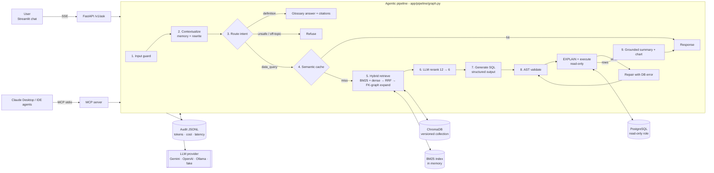
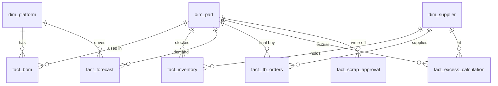

# 📦 E&O Copilot: Agentic RAG Text-to-SQL for Supply-Chain Analytics

> Ask questions about Excess & Obsolete (E&O) inventory in plain English. The copilot retrieves the right
> schema, business rules and worked examples, writes **guarded PostgreSQL**, runs it **read-only**,
> **repairs its own SQL** when it fails, and explains the result with **charts and sources**.
> Every step is traced, evaluated and costed.

[](https://github.com/Nainil30/EandO_Copilot/actions/workflows/ci.yml)


```
You:     Which EOL parts have both LTB orders and excess?
Copilot: <2-4 sentence answer grounded in the returned rows, with the key numbers>
         [bar chart] [SQL tab] [sources: fact_ltb_orders, fact_excess_calculation, glossary: Last Time Buy, ...]
         confidence · latency · LLM calls · tokens · $ cost        (shape of a response, not real output)
```

---

## Table of contents
1. [Why this project](#1-why-this-project)
2. [What it demonstrates (GenAI / RAG concepts)](#2-what-it-demonstrates)
3. [Architecture](#3-architecture)
4. [Request lifecycle, step by step](#4-request-lifecycle-step-by-step)
5. [Quickstart](#5-quickstart)
6. [Using it: UI, API, MCP](#6-using-it)
7. [Evaluation](#7-evaluation)
8. [Security model](#8-security-model)
9. [Observability & cost](#9-observability--cost)
10. [Configuration](#10-configuration)
11. [Project structure](#11-project-structure)
12. [Testing & CI](#12-testing--ci)
13. [Rebuild it from scratch](#13-rebuild-it-from-scratch)
14. [Presenting it in an interview](#14-presenting-it-in-an-interview)
15. [Troubleshooting](#15-troubleshooting)
16. [Roadmap](#16-roadmap)

---

## 1. Why this project

Hardware companies write off millions every year on **excess and obsolete inventory**: parts that will never
be consumed because a platform reached end-of-life, a last-time-buy was over-sized, or demand dropped.
The data needed to manage it (BOMs, inventory, forecasts, LTB orders, scrap approvals) sits in a warehouse
that most operations managers cannot query.

**E&O Copilot** is the internal "ask the warehouse" tool those teams would use. It is built the way a
production GenAI system should be: grounded, guarded, evaluated, observable and model-agnostic. The data is
synthetic (no company data), but the schema, metrics and workflows are realistic.

| Business question | What happens |
|---|---|
| "Top 10 suppliers by excess value" | Joins `fact_excess_calculation` to `dim_part` + `dim_supplier`, applies the glossary formula `calculated_excess * unit_cost` |
| "only the ones in Taiwan" (follow-up) | Conversation memory rewrites it to a standalone question and adds the filter |
| "What does EOSS mean?" | Routed to the glossary (no SQL), answered with citations |
| "Delete all inventory rows" | Blocked before any LLM call. Even if it slipped through, the AST validator and a read-only DB role would stop it |

---

## 2. What it demonstrates

| Area | Technique | Where |
|---|---|---|
| **Retrieval** | Hybrid search: **BM25 (sparse) + embeddings (dense)** | [`app/rag/retriever.py`](app/rag/retriever.py), [`bm25.py`](app/rag/bm25.py) |
| | **Reciprocal Rank Fusion (RRF)** to merge rankings on different scales | `rrf_fuse()` |
| | **Asymmetric embeddings** (`RETRIEVAL_QUERY` vs `RETRIEVAL_DOCUMENT`) + Matryoshka truncation to 768-d | [`app/llm/gemini.py`](app/llm/gemini.py) |
| | **Schema-graph expansion**: auto-add join edges and bridge tables via the FK graph | `expand_with_schema_graph()` |
| | **LLM reranking** (retrieve 12 → keep 6), fails open | [`app/rag/reranker.py`](app/rag/reranker.py) |
| | **Domain-aware chunking**: table-level, join-edge, glossary-section, and question→SQL chunks | [`app/rag/kb_builder.py`](app/rag/kb_builder.py) |
| | **Semantic layer / data dictionary** with column meanings and valid values (value linking) | [`app/sql/catalog.py`](app/sql/catalog.py) |
| | **Dynamic few-shot**: the most similar approved SQL examples are retrieved per question | [`docs/sql_examples.md`](docs/sql_examples.md) |
| | **Context ordering** against "lost in the middle" + character budget | [`app/rag/context.py`](app/rag/context.py) |
| | **Versioned, blue/green index** (`eando_kb_<version>`), content-hashed chunk ids | [`app/rag/vector_store.py`](app/rag/vector_store.py) |
| **Generation** | **Structured outputs** (Pydantic → JSON Schema) for every LLM step | [`app/pipeline/outputs.py`](app/pipeline/outputs.py) |
| | Plan-then-SQL, self-reported **confidence**, **assumptions**, **clarifying questions** | `SQLGeneration` |
| | XML-delimited context, untrusted-input framing, **versioned prompts** | [`app/pipeline/prompts.py`](app/pipeline/prompts.py) |
| **Agentic loop** | Explicit **state graph** (LangGraph-style) with streaming events | [`app/pipeline/graph.py`](app/pipeline/graph.py) |
| | **Intent routing** (data / definition / out-of-scope / unsafe) | `node_route` |
| | **Self-healing SQL**: EXPLAIN pre-flight → DB error → repair, bounded retries | `node_validate_execute` |
| | **Conversation memory + query rewriting** for follow-ups | [`app/pipeline/memory.py`](app/pipeline/memory.py) |
| | **Grounded answer synthesis** + automatic chart selection | `node_summarize` |
| **Safety** | 3 layers: input guard → **sqlglot AST validator** → **read-only role + READ ONLY txn + timeout** | [`app/guardrails`](app/guardrails/input_guard.py), [`app/sql/validator.py`](app/sql/validator.py), [`db/schema.sql`](db/schema.sql) |
| | Prompt-injection heuristics, function/catalog deny-lists, LIMIT injection | |
| **LLMOps** | **Semantic cache** (embedding similarity ≥ 0.95, version-scoped) | [`app/rag/semantic_cache.py`](app/rag/semantic_cache.py) |
| | Token + **cost accounting** per request, per step | [`app/llm/base.py`](app/llm/base.py) |
| | JSONL **audit trail**, feedback loop, online metrics | [`app/observability`](app/observability/audit.py) |
| | Retries with exponential backoff + jitter | `with_retries()` |
| **Evaluation** | **Execution accuracy** vs gold SQL, table recall@context, guardrail block rate, **LLM-as-judge**, CI quality gate | [`evals/run_evals.py`](evals/run_evals.py) |
| **Interop** | **MCP server**: use the copilot from Claude Desktop / Claude Code / Cursor | [`app/mcp_server.py`](app/mcp_server.py) |
| | **Provider-agnostic**: Gemini, OpenAI-compatible (OpenAI, Azure, **Ollama**, vLLM), offline fake | [`app/llm/`](app/llm/factory.py) |
| **Engineering** | FastAPI v1 API, SSE streaming, API keys, rate limiting, request IDs, typed settings | [`app/api`](app/api/main.py), [`app/config.py`](app/config.py) |
| | Docker Compose stack, GitHub Actions (lint, 67 tests, Postgres integration, eval run, image build) | [`docker-compose.yml`](docker-compose.yml), [`.github/workflows/ci.yml`](.github/workflows/ci.yml) |

---

## 3. Architecture



**Components**

| Component | Tech | Responsibility |
|---|---|---|
| Warehouse | PostgreSQL 15 (Docker) | 3 dimension + 6 fact tables, ~8.4K synthetic rows |
| Knowledge base | ChromaDB (cosine, persistent) + rank-bm25 | 54 chunks: 9 tables, 12 join edges, 12 glossary sections, 21 SQL examples |
| LLM layer | google-genai / httpx | `LLMProvider` ABC with `generate_structured()` and `embed()`, usage tracking, retries |
| Pipeline | Plain Python state graph | Nodes are small functions over `PipelineState`; the orchestrator yields events |
| API | FastAPI + Pydantic v2 | REST + SSE, auth, rate limits, typed responses, OpenAPI docs |
| UI | Streamlit | Chat, live step stream, charts, SQL/sources/trace tabs, feedback, observability and KB lab pages |
| Agent interop | MCP Python SDK | Tools: `ask_eando`, `run_readonly_sql`, `describe_schema`, `search_knowledge_base` |

Deeper write-up: [`docs/architecture.md`](docs/architecture.md). Design trade-offs: [`docs/decisions.md`](docs/decisions.md).

### Data model



---

## 4. Request lifecycle, step by step

Example: *"Top 10 suppliers by total excess value"*

| # | Node | What happens | Why it matters |
|---|---|---|---|
| 1 | `guard` | Regex checks for injection phrases, destructive intent, length | Blocks obvious attacks at zero cost (no LLM call) |
| 2 | `contextualize` | If the session has history, rewrite the follow-up into a standalone question and extract schema keywords | "only Taiwan" becomes "Top 10 suppliers by total excess value where country = Taiwan" |
| 3 | `route` | Fast model classifies `data_query / definition / out_of_scope / unsafe` (structured output) | Cheap model for cheap decisions; definitions skip SQL entirely |
| 4 | `cache_lookup` | Embed the question (`RETRIEVAL_QUERY`); cosine ≥ 0.95 against cached questions returns instantly | Paraphrases hit the cache; scoped to KB + prompt version |
| 5 | `retrieve` | Dense top-12 + BM25 top-12 → **RRF** → add join edges / tables implied by top chunks | Dense finds meaning ("over-stock"), BM25 finds identifiers (`calculated_excess`) |
| 6 | `rerank` | Fast LLM selects the 6 most useful chunks; graph-expanded schema is always kept | Precision: less noise means fewer hallucinated joins |
| 7 | `generate_sql` | Smart model returns `{plan, sql, tables_used, assumptions, confidence, needs_clarification}` | Typed output, explainability, and a clarification path instead of guessing |
| 8 | `validate_execute` | sqlglot AST policy + LIMIT injection → `EXPLAIN` pre-flight → execute in READ ONLY txn. On error, the DB message goes back to the model to repair (max 2) | Most text-to-SQL failures are wrong column names, which the repair loop fixes |
| 9 | `summarize` | Fast model writes a 2-4 sentence answer from the actual rows + picks a chart | Grounded in returned data only; the judge eval checks faithfulness |

Every node's latency and payload goes into `trace`, and every LLM call's tokens into `usage`. Both are returned
to the client and written to the audit log.

---

## 5. Quickstart

### Prerequisites
- Python **3.11**, Docker Desktop, Git
- A **Gemini API key** (free tier works): https://aistudio.google.com/apikey.
  No key? Use `LLM_PROVIDER=fake` for a fully offline demo, or point `LLM_PROVIDER=openai` at Ollama.

### Option A: local dev (recommended while learning)

**Windows (PowerShell)**
```powershell
git clone https://github.com/Nainil30/EandO_Copilot.git; cd EandO_Copilot
python -m venv .venv; .\.venv\Scripts\Activate.ps1
pip install -r requirements-dev.txt
Copy-Item .env.example .env        # then edit GEMINI_API_KEY
docker compose up -d postgres
python -m scripts.bootstrap         # schema + read-only role + synthetic data + knowledge base
python -m uvicorn app.api.main:app --reload --port 8000
# new terminal
streamlit run ui/streamlit_app.py
```

**macOS / Linux / WSL**
```bash
git clone https://github.com/Nainil30/EandO_Copilot.git && cd EandO_Copilot
python3.11 -m venv .venv && source .venv/bin/activate
make install && cp .env.example .env   # edit GEMINI_API_KEY
make setup        # starts postgres + bootstrap
make api          # terminal 1
make ui           # terminal 2
```

Open: UI http://localhost:8501 · Swagger http://localhost:8000/docs

### Option B: everything in Docker
```bash
cp .env.example .env                                  # set GEMINI_API_KEY
docker compose up -d postgres
docker compose --profile setup run --rm seed          # one-time bootstrap
docker compose up -d --build                          # api + ui
```

### Option C: offline demo (no API key)
Set `LLM_PROVIDER=fake` in `.env` and run Option A. The deterministic fake provider routes, retrieves,
picks the closest approved SQL example and summarizes. It's useful for demos on restricted networks and is
exactly what the test suite uses.

> Upgrading from v1? The read-only role is created by `db/schema.sql`. `python -m scripts.bootstrap`
> re-applies it idempotently, so no volume reset is needed.

---

## 6. Using it

### Streamlit UI
- **Chat** with live pipeline steps (SSE), answer + insights, auto chart, and tabs for **Data** (CSV download),
  **SQL** (plan, assumptions, repair attempts), **Sources** (RRF / dense / BM25 / rerank ranks per chunk) and
  **Trace** (per-step latency).
- 👍/👎 feedback → `feedback.jsonl` (raw material for new eval cases).
- **Observability** page: success rate, p50/p95, cache hit rate, cost, audit log inspector.
- **Knowledge Base** page: retrieval debugger (dense vs BM25 vs fused vs reranked) and chunk browser.

### REST API (`/docs` for interactive Swagger)

| Method | Path | Purpose |
|---|---|---|
| POST | `/v1/ask` | Full pipeline → typed `AskResponse` |
| POST | `/v1/ask/stream` | Same, as Server-Sent Events (`start`, `step`×N, `final`) |
| POST | `/v1/sql` · `/v1/sql/validate` | Run / validate analyst SQL through the same guardrails |
| GET | `/v1/schema` | Semantic layer (tables, columns, meanings, joins) |
| POST | `/v1/kb/build` · GET `/v1/kb/stats` · `/v1/kb/chunks` | Index management |
| POST | `/v1/retrieve/debug` | Inspect retrieval for a question |
| POST | `/v1/feedback` | Thumbs up/down + optional corrected SQL |
| GET | `/v1/metrics` · `/v1/audit` | Online metrics, audit tail |
| DELETE | `/v1/sessions/{id}` | Clear conversation memory |
| GET | `/health` · `/ready` | Liveness / readiness probes |

```bash
curl -s localhost:8000/v1/ask -H "Content-Type: application/json" \
  -d '{"question":"Top 5 commodities by excess value","session_id":"demo"}' | jq '.answer, .sql'
curl -s localhost:8000/v1/ask -H "Content-Type: application/json" \
  -d '{"question":"now only for EOL parts","session_id":"demo"}' | jq '.standalone_question'
```

### MCP server (use it from Claude Desktop, Claude Code, Cursor...)
```bash
python -m app.mcp_server        # stdio transport
```
Claude Desktop `claude_desktop_config.json`:
```json
{
  "mcpServers": {
    "eando-copilot": {
      "command": "C:/path/to/EandO_Copilot/.venv/Scripts/python.exe",
      "args": ["-m", "app.mcp_server"],
      "cwd": "C:/path/to/EandO_Copilot"
    }
  }
}
```
Claude Code: `claude mcp add eando-copilot -- python -m app.mcp_server` (run from the repo root).
Tools exposed: `ask_eando`, `run_readonly_sql`, `describe_schema`, `search_knowledge_base`.

---

## 7. Evaluation

"It looked right in the demo" is not a metric. [`evals/golden.jsonl`](evals/golden.jsonl) has **37 cases**
across 11 categories (excess, inventory, lifecycle, dates, forecast, BOM, LTB, scrap, joins, edge cases,
limits) plus 6 adversarial **governance** cases and 2 **definition** cases. Most data cases have a hand-written
`gold_sql`.

```bash
python -m evals.run_evals --sleep-ms 300            # in-process (free-tier friendly pacing)
python -m evals.run_evals --api http://127.0.0.1:8000
python -m evals.run_evals --category joins --judge  # + LLM-as-judge faithfulness
python -m evals.run_evals --min-ex 0.75             # CI quality gate: exit 1 if below
```

| Metric | Definition | What it isolates |
|---|---|---|
| **Execution accuracy (EX)** | Predicted result rows == gold rows (order-insensitive multiset), Spider/BIRD style | End-to-end correctness |
| **Soft EX** | Every gold column's values appear in some predicted column | Correct answer with extra columns or different aliases |
| **Table recall@context** | Expected tables ⊆ tables in the context given to the generator | **Retrieval** quality, separate from generation |
| **Guardrail block rate** | Adversarial prompts refused | Safety |
| **Repair rate** | Requests that needed self-correction | Generator robustness and the value of the repair loop |
| **Judge score (1-5)** | LLM-as-judge: is the answer supported by the rows? | Hallucination in the summary |
| Latency p50/p95, tokens, $ | From the usage tracker | Cost/latency budget |

Reports are written to `reports/eval_<ts>.md` and `.json` with a per-category breakdown and a failure list.
**Workflow:** change one thing (prompt, `RRF_K`, `CONTEXT_TOP_N`, reranker on/off, model), re-run, and
compare. Bump `PROMPT_VERSION` / `KB_VERSION` so audit records stay attributable.

> Fill in your own numbers after running with your key, e.g. "Soft EX 0.89, table recall 0.97, 100% guardrail
> block rate, p50 2.3 s, $0.002/question on gemini-2.5-flash". Real measured numbers are the strongest thing
> you can show a recruiter.

---

## 8. Security model

Defence in depth. Any single layer can fail without data being modified.

| Layer | Control | Stops |
|---|---|---|
| 1. Input guard | Injection phrases, destructive intent, 1,000-char cap | "ignore previous instructions", "drop table", token stuffing |
| 2. LLM router | `unsafe` intent → refusal | Subtle paraphrases of destructive requests |
| 3. Prompt design | Rules in system prompt, user input delimited and marked untrusted | Instruction hijacking via the question |
| 4. **AST validator** (sqlglot) | Single statement, `Query` root only, no DML/DDL/COPY/INTO anywhere in the tree (incl. CTEs), table allow-list, no `pg_*`/`information_schema`, function deny-list (`pg_sleep`, `pg_read_file`, `dblink`...), LIMIT injection/clamp | Everything regex validators miss (comments, casing, data-modifying CTEs) |
| 5. Execution | `SET TRANSACTION READ ONLY`, `statement_timeout`, `fetchmany` row cap | Writes, runaway joins, huge payloads |
| 6. Database | `copilot_readonly` role: SELECT-only grants, `default_transaction_read_only=on` | Everything above failing at once (CI asserts a DELETE fails) |
| API | Optional `X-API-Key`, per-client rate limiting, CORS config | Abuse, cost attacks |

Security violations are **never sent to the repair loop**. They end the request.

---

## 9. Observability & cost

- **Per response:** `trace` (step → ms + payload), `usage` (calls, input/output tokens, est. USD), `versions`
  (prompt, KB, provider), `retrieval` (dense / BM25 / expanded ids, rerank reason), `attempts` (repairs).
- **Audit log** `.logs/audit.jsonl`: one record per request, enough to replay any answer.
- **`/v1/metrics`**: success rate, status mix, p50/p95, cache hit rate, repair rate, tokens, cost, feedback.
- **Structured JSON logs** with `X-Request-ID` correlation; `X-Process-Time-Ms` header.
- **Model tiering:** routing, rewrite, rerank and summary use the fast/cheap model; only SQL generation and
  repair use the smart model. Combined with the semantic cache, this cuts cost substantially compared with
  using one big model for every call.

---

## 10. Configuration

All settings live in [`app/config.py`](app/config.py) (pydantic-settings). Override any of them via `.env` or
environment variables. See [`.env.example`](.env.example).

| Variable | Default | Notes |
|---|---|---|
| `LLM_PROVIDER` | `gemini` | `gemini` · `openai` (any OpenAI-compatible URL, incl. Ollama) · `fake` |
| `GEMINI_SQL_MODEL` / `GEMINI_FAST_MODEL` | `gemini-2.5-flash` / `-flash-lite` | Smart vs fast tier |
| `GEMINI_EMBED_MODEL`, `EMBEDDING_DIM` | `gemini-embedding-001`, 768 | Matryoshka truncation |
| `RETRIEVAL_TOP_K`, `CONTEXT_TOP_N`, `RRF_K` | 12, 6, 60 | Retrieval funnel |
| `USE_RERANK`, `USE_QUERY_REWRITE`, `USE_SEMANTIC_CACHE` | true | Feature flags for ablations |
| `SEMANTIC_CACHE_THRESHOLD` | 0.95 | Cosine similarity for a cache hit |
| `MAX_REPAIR_ATTEMPTS` | 2 | Self-healing budget |
| `SQL_STATEMENT_TIMEOUT_MS`, `SQL_MAX_ROWS`, `SQL_DEFAULT_LIMIT` | 8000, 1000, 100 | Execution guardrails |
| `READONLY_DATABASE_URL` | – | Least-privilege role for generated SQL |
| `KB_VERSION`, `PROMPT_VERSION` | v2, sql-v3 | Written to every audit record |
| `API_KEYS`, `RATE_LIMIT_PER_MINUTE` | empty, 60 | Empty = auth off (dev) |

---

## 11. Project structure

```
app/
  config.py                 typed settings (single source of truth)
  api/                      FastAPI app, request/response schemas, auth + rate limiting
  pipeline/
    graph.py                agentic state graph + streaming orchestrator
    prompts.py              versioned prompt templates
    outputs.py              Pydantic structured-output contracts
    memory.py               conversation memory
  rag/
    kb_builder.py           chunking + indexing
    retriever.py            hybrid retrieval, RRF, FK-graph expansion
    bm25.py                 cached sparse index
    reranker.py             LLM reranker (fail-open)
    context.py              ordered, budgeted context assembly
    semantic_cache.py       embedding-similarity cache
    vector_store.py         Chroma wrapper (versioned collections)
  sql/
    catalog.py              semantic layer: tables, columns, values, joins
    validator.py            sqlglot AST guardrails
    executor.py             read-only, time-boxed execution + EXPLAIN
  llm/                      provider ABC, Gemini, OpenAI-compatible, fake
  guardrails/input_guard.py injection / destructive-intent checks
  observability/            audit log, metrics, JSON logging
  mcp_server.py             MCP tools for external agents
ui/                         Streamlit chat + Observability + Knowledge Base pages
evals/                      golden set + evaluation harness
tests/                      67 offline tests (fake LLM, fake warehouse)
scripts/                    data generator, loader, one-command bootstrap
docs/                       glossary + SQL examples (KB sources), architecture, ADRs, guides
db/schema.sql               warehouse DDL, indexes, read-only role
```

---

## 12. Testing & CI

```bash
pytest                 # 67 tests, ~5 s, no API key / Docker / DB needed
ruff check . && ruff format --check app tests evals scripts
```

Tests cover the AST validator (injection, CTE writes, catalog access, LIMIT policy), input guard, RRF math,
BM25 tokenization, graph expansion, context ordering, chunking, the full pipeline (routing, definitions,
**self-repair**, bounded retries, SQL-only mode, **semantic cache**, streaming, **follow-up memory**), structured
output parsing, every API endpoint (incl. SSE and auth) and the eval metrics.

GitHub Actions ([`ci.yml`](.github/workflows/ci.yml)): **lint + unit tests** → **integration** (Postgres
service, bootstrap, asserts the read-only role rejects writes, runs the eval harness, uploads the report) →
**Docker build**.

---

## 13. Rebuild it from scratch

A phase-by-phase guide, with what to build, why, and how to verify each phase, is in
[`docs/rebuild_guide.md`](docs/rebuild_guide.md). Short version:

1. **Warehouse:** Docker Postgres, star schema, synthetic data generator, loader.
2. **Baseline text-to-SQL:** schema in the prompt → SQL → execute. Measure it, then watch it fail on joins.
3. **Guardrails:** sqlglot validator, read-only role, timeouts.
4. **RAG v1:** chunk schema / glossary / examples, embed into Chroma, dense retrieval.
5. **Hybrid + RRF + graph expansion:** add BM25, fuse, expand along FKs.
6. **Reranking + structured outputs.**
7. **Agentic loop:** routing, EXPLAIN pre-flight, self-repair, summarization.
8. **Memory, semantic cache, streaming.**
9. **Evals:** golden set, EX, recall, judge, then iterate on what fails.
10. **Productionize:** API auth, rate limits, audit, metrics, Docker, CI, MCP.

---

## 14. Presenting it in an interview

A full talk track with likely questions and strong answers is in
[`docs/interview_guide.md`](docs/interview_guide.md). The 60-second pitch:

> "I built an agentic RAG copilot that lets supply-chain managers query an E&O inventory warehouse in plain
> English. Retrieval is hybrid: BM25 plus Gemini embeddings fused with Reciprocal Rank Fusion, then expanded
> along the foreign-key graph so the model always sees the join path, and reranked by a small LLM. Generation
> uses structured outputs with a plan, confidence and assumptions. SQL goes through an AST-level validator
> and runs on a read-only role, and if Postgres rejects it, the error is fed back for a bounded self-repair.
> Everything is traced and costed, there's a semantic cache and conversation memory, and I evaluate it on a
> golden set with execution accuracy, retrieval recall and an LLM judge, gated in CI. It's also exposed as an
> MCP server, so Claude or Cursor can use it as a tool."

---

## 15. Troubleshooting

| Symptom | Fix |
|---|---|
| `/ready` says `degraded`, DB ❌ | `docker compose up -d postgres`; check `DATABASE_URL` |
| KB 0 chunks | `python -m scripts.bootstrap --kb-only` or the UI's **Build KB** |
| `API key not valid` | Regenerate at AI Studio, update `GEMINI_API_KEY`, restart the API |
| 429 / `RESOURCE_EXHAUSTED` | Free-tier limit. Retries back off automatically; for evals use `--sleep-ms 500` |
| `password authentication failed for copilot_readonly` | Run `python -m scripts.bootstrap` (re-applies the role) or unset `READONLY_DATABASE_URL` |
| Chroma / NumPy errors | Keep `numpy<2` (pinned) and Python 3.11 |
| Changed glossary / examples but answers didn't change | Rebuild the KB; bump `KB_VERSION` to invalidate the semantic cache |

---

## 16. Roadmap

- `pgvector` + Postgres full-text search to collapse the vector store into the warehouse
- Cross-encoder reranker (e.g. `bge-reranker`) as a local alternative to the LLM reranker
- OpenTelemetry / Langfuse export of traces
- Row-level security per business unit, with user identity passed to Postgres
- Feedback → eval-set promotion workflow (thumbs-down + corrected SQL becomes a new golden case)
- Redis-backed memory, cache and rate limiting for multi-replica deployment

---

*Synthetic data only. Built by [Nainil](https://github.com/Nainil30) as a reference implementation of
production-grade RAG and agentic text-to-SQL.*
