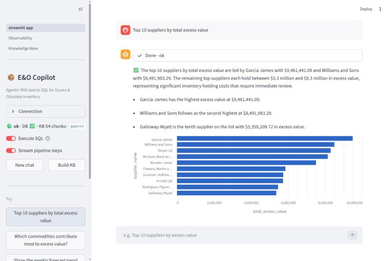
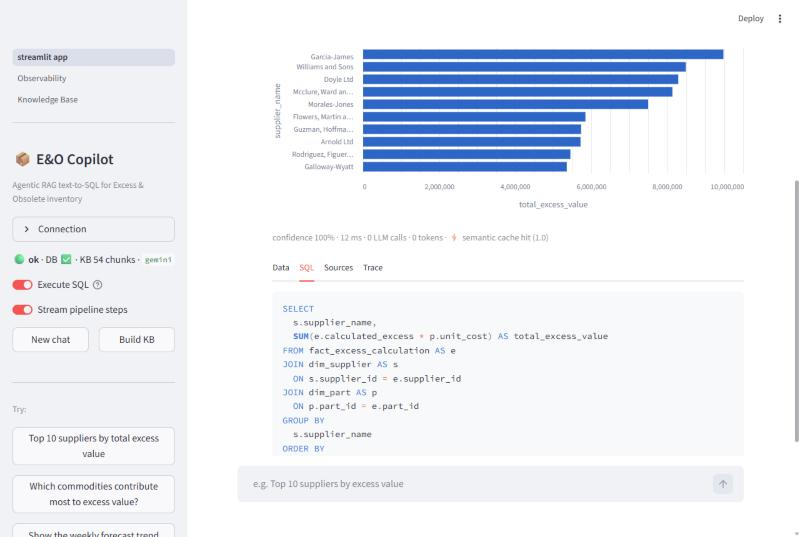
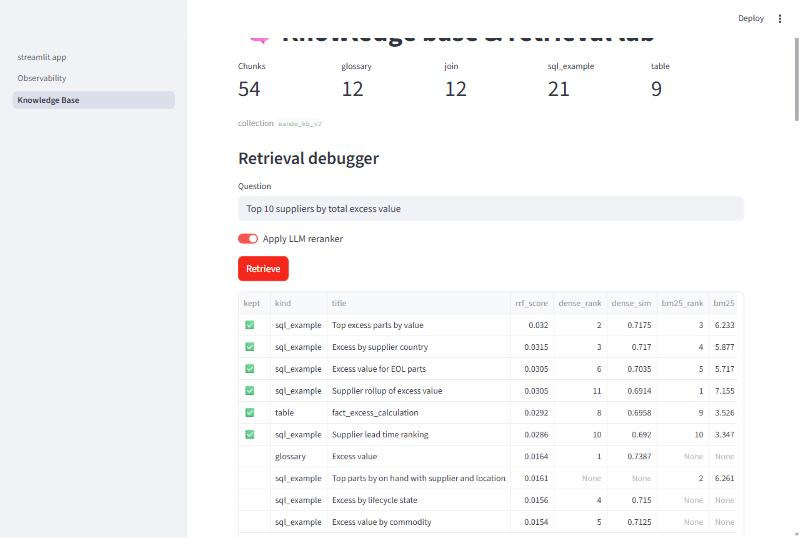
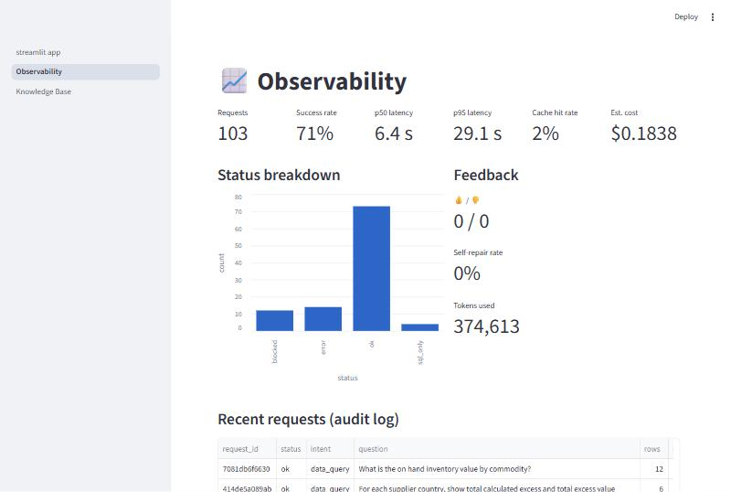
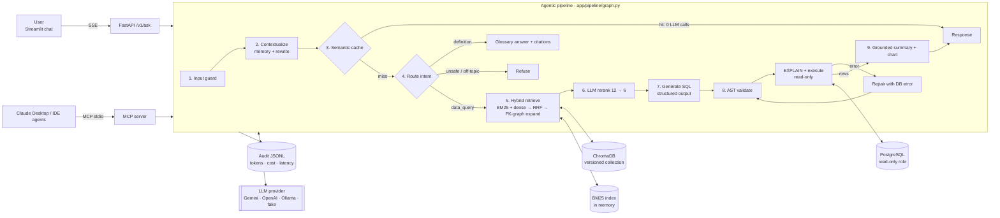
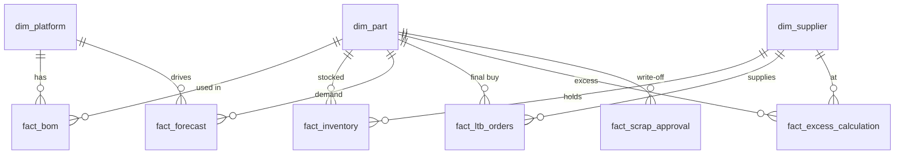

# 📦 E&O Copilot: Agentic RAG Text-to-SQL for Supply-Chain Analytics

> **An agentic RAG text-to-SQL copilot for supply-chain E&O inventory — built to production engineering
> standards: hybrid retrieval, AST-guarded SQL, self-healing execution, evaluation harness, Datadog
> instrumentation, and Kubernetes-ready deployment.**

[](https://github.com/Nainil30/EandO_Copilot/actions/workflows/ci.yml)


Ask questions about Excess & Obsolete (E&O) inventory in plain English. The copilot retrieves the right
schema, business rules and worked examples, writes **guarded PostgreSQL**, runs it **read-only**,
**repairs its own SQL** when it fails, and explains the result with **charts and sources**.
Every step is traced, evaluated and costed.



**Measured results** ([details](docs/eval_results.md)): **37/37** golden cases pass · **100%** soft execution
accuracy · **100%** retrieval table recall · **6/6** attacks blocked · ~5 s p50 · ~4.4K tokens/question ·
**$0** on the Gemini free tier, with a hard daily usage cap.

| SQL tab + semantic-cache hit (0 LLM calls) | Retrieval lab: dense vs BM25 vs RRF fusion | Observability |
|---|---|---|
|  |  |  |

**Study material:** [docs/concepts.md](docs/concepts.md) (all 44 concepts: *what, why, alternatives, where in
the code*) · [docs/sql_interview_qa.md](docs/sql_interview_qa.md) (12 SQL questions on this schema) ·
[docs/interview_guide.md](docs/interview_guide.md) (talk track) · [k8s/README.md](k8s/README.md) (deployment).

---

## Table of contents
1. [Pitch and why this project](#1-pitch-and-why-this-project)
2. [Tech stack](#2-tech-stack)
3. [Architecture](#3-architecture)
4. [Data model](#4-data-model)
5. [Request lifecycle, step by step](#5-request-lifecycle-step-by-step)
6. [Quickstart and usage](#6-quickstart-and-usage)
7. [Evaluation](#7-evaluation)
8. [Security model](#8-security-model)
9. [Observability & Datadog](#9-observability--datadog)
10. [Kubernetes deployment](#10-kubernetes-deployment)
11. [Configuration](#11-configuration)
12. [Project structure](#12-project-structure)
13. [Testing & CI](#13-testing--ci)
14. [Presenting it in an interview](#14-presenting-it-in-an-interview)
15. [Troubleshooting](#15-troubleshooting)
16. [Roadmap](#16-roadmap)

---

## 1. Pitch and why this project

**One line:** an agentic RAG text-to-SQL copilot for supply-chain E&O inventory — built to production
engineering standards: hybrid retrieval, AST-guarded SQL, self-healing execution, evaluation harness, Datadog
instrumentation, and Kubernetes-ready deployment.

Hardware companies write off millions every year on **excess and obsolete inventory**: parts that will never
be consumed because a platform reached end-of-life, a last-time-buy was over-sized, or demand dropped.
The data needed to manage it (BOMs, inventory, forecasts, LTB orders, scrap approvals) sits in a warehouse
that most operations managers cannot query.

**E&O Copilot** is the internal "ask the warehouse" tool those teams would use. It is built the way a
production GenAI system should be: grounded, guarded, evaluated, observable and model-agnostic. The data is
synthetic (no company data), but the schema, metrics and workflows are realistic.

| Business question | What happens |
|---|---|
| "Top 10 suppliers by excess value" | Joins `fact_excess_calculation` to `dim_part` + `dim_supplier`, applies the glossary formula `calculated_excess * unit_cost` |
| "only the ones in Taiwan" (follow-up) | Conversation memory rewrites it to a standalone question and adds the filter |
| "What does EOSS mean?" | Routed to the glossary (no SQL), answered with citations |
| "Delete all inventory rows" | Blocked before any LLM call. Even if it slipped through, the AST validator and a read-only DB role would stop it |

### How it works, for a non-technical manager
1. Start the database (Docker), the API and the Streamlit UI (see [Quickstart](#6-quickstart-and-usage)).
2. Ask a question in plain English, e.g. *"Top 10 parts by excess value for EOL parts"*.
3. The copilot finds the relevant schema, business definitions and approved query patterns, writes one safe
   SQL query, checks it, and runs it read-only.
4. You get a short answer, a chart and the results table, plus the evidence: the SQL itself and which
   documents shaped it (the **Sources** tab).
5. Ask a follow-up like *"only Taiwan"* and it remembers the context. Click 👍/👎 to help it improve.

---

## 2. Tech stack

| Layer | Technology | Why chosen |
|---|---|---|
| Warehouse | **PostgreSQL 15** | Relational star schema with FKs, indexes and real role-based security (the read-only role is the last line of defence). The right size for interactive analytics on structured data; no cluster needed |
| Vector store | **ChromaDB** | Embedded and persistent, zero infrastructure, cosine search. Versioned collections give blue/green KB rebuilds. Swappable for pgvector later |
| Sparse retrieval | **BM25** (`rank-bm25`) | Matches exact identifiers (`calculated_excess`, `EOSS`) that embeddings blur. In-memory, rebuilt from the same chunks |
| LLM | **Gemini API** (`google-genai`) | Free tier, strong structured outputs, asymmetric embeddings. Behind an `LLMProvider` interface, so OpenAI / Ollama / an offline fake are config switches |
| API | **FastAPI** | Typed request/response models (Pydantic v2), auto OpenAPI docs, SSE streaming, dependency-injected auth and rate limiting |
| UI | **Streamlit** | A data-app UI in pure Python: chat, charts, tables, debug pages, no front-end build |
| Orchestration | **LangGraph-style state graph** (plain Python) | Every node is a small, unit-testable function over one state object; streaming and tracing come for free; maps 1:1 onto LangGraph if a team standardizes on it |
| Deployment | **Docker + Kubernetes** | One image, reproducible everywhere. Compose for dev; K8s manifests add replicas, probes, autoscaling and persistent storage |
| Metrics | **Datadog StatsD** (`datadog`) | Real-time counters/histograms over UDP to the Datadog Agent: dashboards and alerts on traffic, latency, cost, cache and guardrails |
| CI | **GitHub Actions** | Lint, 75 offline tests, Postgres integration test that proves the read-only role rejects writes, eval run, Docker build |
| Agent interop | **MCP** (Model Context Protocol) | Exposes the copilot as tools to Claude Desktop, Claude Code, Cursor and other agents |

---

## 3. Architecture



**Components**

| Component | Tech | Responsibility |
|---|---|---|
| Warehouse | PostgreSQL 15 (Docker) | 3 dimension + 6 fact tables, ~8.4K synthetic rows |
| Knowledge base | ChromaDB (cosine, persistent) + rank-bm25 | 54 chunks: 9 tables, 12 join edges, 12 glossary sections, 21 SQL examples |
| LLM layer | google-genai / httpx | `LLMProvider` ABC with `generate_structured()` and `embed()`, usage tracking, retries |
| Pipeline | Plain Python state graph | Nodes are small functions over `PipelineState`; the orchestrator yields events |
| API | FastAPI + Pydantic v2 | REST + SSE, auth, rate limits, typed responses, OpenAPI docs |
| UI | Streamlit | Chat, live step stream, charts, SQL/sources/trace tabs, feedback, observability and KB lab pages |
| Agent interop | MCP Python SDK | Tools: `ask_eando`, `run_readonly_sql`, `describe_schema`, `search_knowledge_base` |

Deeper write-up: [`docs/architecture.md`](docs/architecture.md). Design trade-offs: [`docs/decisions.md`](docs/decisions.md).
**Every concept explained (what / why / alternatives / where in code): [`docs/concepts.md`](docs/concepts.md).**

### What it demonstrates

| Area | Technique | Where |
|---|---|---|
| **Retrieval** | Hybrid search: **BM25 (sparse) + embeddings (dense)** | [`app/rag/retriever.py`](app/rag/retriever.py), [`bm25.py`](app/rag/bm25.py) |
| | **Reciprocal Rank Fusion (RRF)** to merge rankings on different scales | `rrf_fuse()` |
| | **Asymmetric embeddings** (`RETRIEVAL_QUERY` vs `RETRIEVAL_DOCUMENT`) + Matryoshka truncation to 768-d | [`app/llm/gemini.py`](app/llm/gemini.py) |
| | **Schema-graph expansion**: auto-add join edges and bridge tables via the FK graph | `expand_with_schema_graph()` |
| | **LLM reranking** (retrieve 12 → keep 6), fails open | [`app/rag/reranker.py`](app/rag/reranker.py) |
| | **Domain-aware chunking**: table-level, join-edge, glossary-section, and question→SQL chunks | [`app/rag/kb_builder.py`](app/rag/kb_builder.py) |
| | **Semantic layer / data dictionary** with column meanings and valid values (value linking) | [`app/sql/catalog.py`](app/sql/catalog.py) |
| | **Dynamic few-shot**: the most similar approved SQL examples are retrieved per question | [`docs/sql_examples.md`](docs/sql_examples.md) |
| | **Context ordering** against "lost in the middle" + character budget | [`app/rag/context.py`](app/rag/context.py) |
| | **Versioned, blue/green index** (`eando_kb_<version>`), content-hashed chunk ids | [`app/rag/vector_store.py`](app/rag/vector_store.py) |
| **Generation** | **Structured outputs** (Pydantic → JSON Schema) for every LLM step | [`app/pipeline/outputs.py`](app/pipeline/outputs.py) |
| | Plan-then-SQL, self-reported **confidence**, **assumptions**, **clarifying questions** | `SQLGeneration` |
| | XML-delimited context, untrusted-input framing, **versioned prompts** | [`app/pipeline/prompts.py`](app/pipeline/prompts.py) |
| **Agentic loop** | Explicit **state graph** (LangGraph-style) with streaming events | [`app/pipeline/graph.py`](app/pipeline/graph.py) |
| | **Intent routing** (data / definition / out-of-scope / unsafe) | `node_route` |
| | **Self-healing SQL**: EXPLAIN pre-flight → DB error → repair, bounded retries | `node_validate_execute` |
| | **Conversation memory + query rewriting** for follow-ups | [`app/pipeline/memory.py`](app/pipeline/memory.py) |
| | **Grounded answer synthesis** + automatic chart selection | `node_summarize` |
| **Safety** | 3 layers: input guard → **sqlglot AST validator** → **read-only role + READ ONLY txn + timeout** | [`app/guardrails`](app/guardrails/input_guard.py), [`app/sql/validator.py`](app/sql/validator.py), [`db/schema.sql`](db/schema.sql) |
| | Prompt-injection heuristics, function/catalog deny-lists, LIMIT injection | |
| **LLMOps** | **Hard daily usage budget** (calls + tokens), refused before any API request | [`app/llm/budget.py`](app/llm/budget.py) |
| | **Semantic cache** (embedding similarity ≥ 0.95, version-scoped): repeats cost 0 LLM calls | [`app/rag/semantic_cache.py`](app/rag/semantic_cache.py) |
| | **Embedding cache**: KB rebuilds cost 0 API calls | `LLMProvider.embed()` |
| | Token + **cost accounting** per request, per step | [`app/llm/base.py`](app/llm/base.py) |
| | JSONL **audit trail**, feedback loop, online metrics | [`app/observability`](app/observability/audit.py) |
| | **Datadog metrics** (7 metrics, StatsD, no-op when disabled) | [`app/observability/datadog_metrics.py`](app/observability/datadog_metrics.py) |
| | Retries with exponential backoff + jitter, **model fallback chain** on 503/429 | `with_retries()`, `GeminiProvider._generate_text` |
| **Evaluation** | **Execution accuracy** vs gold SQL, table recall@context, guardrail block rate, **LLM-as-judge**, CI quality gate | [`evals/run_evals.py`](evals/run_evals.py) |
| **Interop** | **MCP server**: use the copilot from Claude Desktop / Claude Code / Cursor | [`app/mcp_server.py`](app/mcp_server.py) |
| | **Provider-agnostic**: Gemini, OpenAI-compatible (OpenAI, Azure, **Ollama**, vLLM), offline fake | [`app/llm/`](app/llm/factory.py) |
| **Engineering** | FastAPI v1 API, SSE streaming, API keys, rate limiting, request IDs, typed settings | [`app/api`](app/api/main.py), [`app/config.py`](app/config.py) |
| | Docker Compose stack, GitHub Actions (lint, 75 tests, Postgres integration, eval run, image build) | [`docker-compose.yml`](docker-compose.yml), [`.github/workflows/ci.yml`](.github/workflows/ci.yml) |
| | **Kubernetes manifests**: namespace, ConfigMap, Secret, PVC, probes, HPA | [`k8s/`](k8s/README.md) |

---

## 4. Data model



**Why a star schema.** The warehouse separates **dimensions** (the nouns: parts, suppliers, platforms, with
descriptive attributes like commodity, country, lifecycle state) from **facts** (the events and measurements:
inventory snapshots, weekly forecasts, LTB orders, excess calculations, scrap approvals). Each fact row holds
foreign keys plus numbers, and each descriptive attribute lives in exactly one place. A flat CSV would repeat
`commodity`, `unit_cost` and `supplier_name` on every inventory and forecast row, so a cost change means
updating thousands of rows and the copies drift apart. In the star schema it's one row in `dim_part`.
Supply-chain questions are almost always *"measure X, sliced by attribute Y, filtered by Z"* ("excess value by
supplier country for EOL parts"), and the star shape turns every one of those into the same pattern: start
from a fact, join one or two dimensions on a key, filter, `GROUP BY`. That predictability is also what makes
text-to-SQL reliable: the model learns one join pattern instead of guessing. (Strictly it's a *fact
constellation*: several fact tables share the same conformed dimensions, so you can compare inventory to
forecast for the same part.) Twelve worked SQL questions on this schema are in
[`docs/sql_interview_qa.md`](docs/sql_interview_qa.md).

---

## 5. Request lifecycle, step by step

Example: *"Top 10 suppliers by total excess value"*

| # | Node | What happens | Why it matters |
|---|---|---|---|
| 1 | `guard` | Regex checks for injection phrases, destructive intent, length | Blocks obvious attacks at zero cost (no LLM call) |
| 2 | `contextualize` | If the session has history, rewrite the follow-up into a standalone question and extract schema keywords | "only Taiwan" becomes "Top 10 suppliers by total excess value where country = Taiwan" |
| 3 | `cache_lookup` | Embed the question (`RETRIEVAL_QUERY`); cosine ≥ 0.95 against cached questions returns instantly, **before** routing, so a repeat costs 0 LLM calls | Paraphrases hit the cache; scoped to KB + prompt version |
| 4 | `route` | Fast model classifies `data_query / definition / out_of_scope / unsafe` (structured output) | Cheap model for cheap decisions; definitions skip SQL entirely |
| 5 | `retrieve` | Dense top-12 + BM25 top-12 → **RRF** → add join edges / tables implied by top chunks | Dense finds meaning ("over-stock"), BM25 finds identifiers (`calculated_excess`) |
| 6 | `rerank` | Fast LLM selects the 6 most useful chunks; graph-expanded schema is always kept | Precision: less noise means fewer hallucinated joins |
| 7 | `generate_sql` | Smart model returns `{plan, sql, tables_used, assumptions, confidence, needs_clarification}` | Typed output, explainability, and a clarification path instead of guessing |
| 8 | `validate_execute` | sqlglot AST policy + LIMIT injection → `EXPLAIN` pre-flight → execute in READ ONLY txn. On error, the DB message goes back to the model to repair (max 2) | Most text-to-SQL failures are wrong column names, which the repair loop fixes |
| 9 | `summarize` | Fast model writes a 2-4 sentence answer from the actual rows + picks a chart | Grounded in returned data only; the judge eval checks faithfulness |

Every node's latency and payload goes into `trace`, and every LLM call's tokens into `usage`. Both are returned
to the client and written to the audit log.

> **What to say in a demo**
>
> **1. "Top 10 suppliers by total excess value."** "Watch the steps stream in: guard, retrieve, rerank,
> generate, validate, execute, summarize. The answer joins three tables and multiplies excess units by unit
> cost, which is the business definition from the glossary, not something the model guessed. The Sources tab
> shows why: the dense and BM25 ranks for each chunk and what the reranker kept."
>
> **2. "Only the ones in Taiwan."** "This follow-up makes no sense on its own, so the contextualize step rewrote
> it into a full standalone question, which you can see in the trace. Everything downstream (cache, retrieval,
> SQL) works on that rewritten question. That's how conversation memory works without stuffing the whole chat
> history into every prompt."
>
> **3. "What does EOSS mean?"** "The router classified this as a definition, so no SQL was generated or run. It
> answered from the business glossary with a citation. Routing first means cheap questions take the cheap path."
>
> **4. "Delete all inventory rows."** "Blocked by the input guard with zero LLM calls, so attacks cost nothing.
> If a cleverer phrasing got past it, the AST validator rejects anything that isn't a single SELECT, and the
> database role physically can't write. Three independent layers, and CI proves the last one."
>
> **5. Ask question 1 again.** "Semantic cache hit: about 12 ms and zero LLM calls instead of several seconds.
> The cache matches on embedding similarity, so a paraphrase also hits. It's scoped to the KB and prompt version,
> so changing either one can't serve a stale answer."

---

## 6. Quickstart and usage

### Prerequisites
- Python **3.11**, Docker Desktop, Git
- A **Gemini API key** (free tier works): https://aistudio.google.com/apikey.
  No key? Use `LLM_PROVIDER=fake` for a fully offline demo, or point `LLM_PROVIDER=openai` at Ollama.

### Option A: local dev (recommended while learning)

**Windows (PowerShell)**
```powershell
git clone https://github.com/Nainil30/EandO_Copilot.git; cd EandO_Copilot
python -m venv .venv; .\.venv\Scripts\Activate.ps1
pip install -r requirements-dev.txt
Copy-Item .env.example .env        # then edit GEMINI_API_KEY
docker compose up -d postgres
python -m scripts.bootstrap         # schema + read-only role + synthetic data + knowledge base
python -m uvicorn app.api.main:app --reload --port 8000
# new terminal
streamlit run ui/streamlit_app.py
```

**macOS / Linux / WSL**
```bash
git clone https://github.com/Nainil30/EandO_Copilot.git && cd EandO_Copilot
python3.11 -m venv .venv && source .venv/bin/activate
make install && cp .env.example .env   # edit GEMINI_API_KEY
make setup        # starts postgres + bootstrap
make api          # terminal 1
make ui           # terminal 2
```

Open: UI http://localhost:8501 · Swagger http://localhost:8000/docs

### Option B: everything in Docker
```bash
cp .env.example .env                                  # set GEMINI_API_KEY
docker compose up -d postgres
docker compose --profile setup run --rm seed          # one-time bootstrap
docker compose up -d --build                          # api + ui
```

### Option C: offline demo (no API key)
Set `LLM_PROVIDER=fake` in `.env` and run Option A. The deterministic fake provider routes, retrieves,
picks the closest approved SQL example and summarizes. It's useful for demos on restricted networks and is
exactly what the test suite uses.

> Upgrading from v1? The read-only role is created by `db/schema.sql`. `python -m scripts.bootstrap`
> re-applies it idempotently, so no volume reset is needed.

### Option D: Kubernetes
See [Kubernetes deployment](#10-kubernetes-deployment) and [`k8s/README.md`](k8s/README.md).

### Streamlit UI
- **Chat** with live pipeline steps (SSE), answer + insights, auto chart, and tabs for **Data** (CSV download),
  **SQL** (plan, assumptions, repair attempts), **Sources** (RRF / dense / BM25 / rerank ranks per chunk) and
  **Trace** (per-step latency).
- 👍/👎 feedback → `feedback.jsonl` (raw material for new eval cases).
- **Observability** page: success rate, p50/p95, cache hit rate, cost, audit log inspector.
- **Knowledge Base** page: retrieval debugger (dense vs BM25 vs fused vs reranked) and chunk browser.

### REST API (`/docs` for interactive Swagger)

| Method | Path | Purpose |
|---|---|---|
| POST | `/v1/ask` | Full pipeline → typed `AskResponse` |
| POST | `/v1/ask/stream` | Same, as Server-Sent Events (`start`, `step`×N, `final`) |
| POST | `/v1/sql` · `/v1/sql/validate` | Run / validate analyst SQL through the same guardrails |
| GET | `/v1/schema` | Semantic layer (tables, columns, meanings, joins) |
| POST | `/v1/kb/build` · GET `/v1/kb/stats` · `/v1/kb/chunks` | Index management |
| POST | `/v1/retrieve/debug` | Inspect retrieval for a question |
| POST | `/v1/feedback` | Thumbs up/down + optional corrected SQL |
| GET | `/v1/metrics` · `/v1/audit` | Online metrics, audit tail |
| DELETE | `/v1/sessions/{id}` | Clear conversation memory |
| GET | `/health` · `/ready` | Liveness / readiness probes |

```bash
curl -s localhost:8000/v1/ask -H "Content-Type: application/json" \
  -d '{"question":"Top 5 commodities by excess value","session_id":"demo"}' | jq '.answer, .sql'
curl -s localhost:8000/v1/ask -H "Content-Type: application/json" \
  -d '{"question":"now only for EOL parts","session_id":"demo"}' | jq '.standalone_question'
```

### MCP server (use it from Claude Desktop, Claude Code, Cursor...)
```bash
python -m app.mcp_server        # stdio transport
```
Claude Desktop `claude_desktop_config.json`:
```json
{
  "mcpServers": {
    "eando-copilot": {
      "command": "C:/path/to/EandO_Copilot/.venv/Scripts/python.exe",
      "args": ["-m", "app.mcp_server"],
      "cwd": "C:/path/to/EandO_Copilot"
    }
  }
}
```
Claude Code: `claude mcp add eando-copilot -- python -m app.mcp_server` (run from the repo root).
Tools exposed: `ask_eando`, `run_readonly_sql`, `describe_schema`, `search_knowledge_base`.

---

## 7. Evaluation

"It looked right in the demo" is not a metric. [`evals/golden.jsonl`](evals/golden.jsonl) has **37 cases**
across 11 data categories (excess, inventory, lifecycle, dates, forecast, BOM, LTB, scrap, joins, edge cases,
limits) plus 6 adversarial **governance** cases and 2 **definition** cases. Most data cases have a hand-written
`gold_sql`.

```bash
python -m evals.run_evals --sleep-ms 300            # in-process (free-tier friendly pacing)
python -m evals.run_evals --api http://127.0.0.1:8000
python -m evals.run_evals --category joins --judge  # + LLM-as-judge faithfulness
python -m evals.run_evals --min-ex 0.75             # CI quality gate: exit 1 if below
```

| Metric | Definition | What it isolates |
|---|---|---|
| **Execution accuracy (EX)** | Predicted result rows == gold rows (order-insensitive multiset), Spider/BIRD style | End-to-end correctness |
| **Soft EX** | Every gold column's values appear in some predicted column | Correct answer with extra columns or different aliases |
| **Table recall@context** | Expected tables ⊆ tables in the context given to the generator | **Retrieval** quality, separate from generation |
| **Guardrail block rate** | Adversarial prompts refused | Safety |
| **Repair rate** | Requests that needed self-correction | Generator robustness and the value of the repair loop |
| **Judge score (1-5)** | LLM-as-judge: is the answer supported by the rows? | Hallucination in the summary |
| Latency p50/p95, tokens, $ | From the usage tracker | Cost/latency budget |

Reports are written to `reports/eval_<ts>.md` and `.json` with a per-category breakdown and a failure list.
**Workflow:** change one thing (prompt, `RRF_K`, `CONTEXT_TOP_N`, reranker on/off, model), re-run, and
compare. Bump `PROMPT_VERSION` / `KB_VERSION` so audit records stay attributable.

### Measured results (2026-11-07, real Gemini + Postgres)

| Metric | Result |
|---|---|
| Golden cases passing | **37 / 37** (all 13 categories) |
| Soft execution accuracy (26 gold-SQL cases) | **100%** |
| Strict execution accuracy | 58% (the model adds helpful extra columns) |
| Table recall @ context | **100%** |
| Guardrail block rate | **6 / 6** |
| Latency p50 | ~5 s (free tier) |
| Tokens / question | ~4,400 → about $0.002 at list price, **$0 on the free tier** |

Getting there took eight diagnosed issues: a retired model, provider overload, a DNS blip, two ambiguous gold
answers, a data-generator bug (Faker `"-12m"` = minutes!), a free-tier rate limit, and one genuine model error
(few-shot over-copying, fixed with prompt `sql-v4`). The full iteration log is in
**[docs/eval_results.md](docs/eval_results.md)**.

### Why evaluation matters for a DE role

An evaluation harness is a data quality pipeline pointed at a model. Execution accuracy is a **reconciliation
check**: the same idea as comparing a pipeline's output table to a trusted source, row for row, and failing
the load when they differ. Retrieval recall is **upstream completeness**: did the stage that feeds the model get
all the inputs it needed, the same way a DE checks that every expected source file or partition arrived before
transforming it. Judge scores are a **semantic validity** check on the output, like asserting a revenue column
is never negative. Running all of it in CI with a `--min-ex` threshold is a quality gate that blocks a bad
change before it ships, exactly how dbt tests or Great Expectations suites gate a production data pipeline.
And the first real failure it caught was a **data bug** (every LTB date collapsed to today), not a model bug,
which is the most DE lesson in the project.

---

## 8. Security model

Defence in depth. Any single layer can fail without data being modified.

| Layer | Control | Stops |
|---|---|---|
| 1. Input guard | Injection phrases, destructive intent, 1,000-char cap | "ignore previous instructions", "drop table", token stuffing |
| 2. LLM router | `unsafe` intent → refusal | Subtle paraphrases of destructive requests |
| 3. Prompt design | Rules in system prompt, user input delimited and marked untrusted | Instruction hijacking via the question |
| 4. **AST validator** (sqlglot) | Single statement, `Query` root only, no DML/DDL/COPY/INTO anywhere in the tree (incl. CTEs), table allow-list, no `pg_*`/`information_schema`, function deny-list (`pg_sleep`, `pg_read_file`, `dblink`...), LIMIT injection/clamp | Everything regex validators miss (comments, casing, data-modifying CTEs) |
| 5. Execution | `SET TRANSACTION READ ONLY`, `statement_timeout`, `fetchmany` row cap | Writes, runaway joins, huge payloads |
| 6. Database | `copilot_readonly` role: SELECT-only grants, `default_transaction_read_only=on` | Everything above failing at once (CI asserts a DELETE fails) |
| API | Optional `X-API-Key`, per-client rate limiting, CORS config | Abuse, cost attacks |

Security violations are **never sent to the repair loop**. They end the request.

---

## 9. Observability & Datadog

### What already exists: local, structured, queryable

- **Per response:** `trace` (step → ms + payload), `usage` (calls, input/output tokens, est. USD), `versions`
  (prompt, KB, provider), `retrieval` (dense / BM25 / expanded ids, rerank reason), `attempts` (repairs).
- **Audit log** `.logs/audit.jsonl`: one JSON record per request, enough to replay any answer. Because it is
  structured, it is queryable: load it with pandas or DuckDB and ask "which questions needed a repair last week?"
- **`/v1/metrics`**: success rate, status mix, p50/p95, cache hit rate, repair rate, tokens, cost, feedback.
- **Structured JSON logs** with `X-Request-ID` correlation; `X-Process-Time-Ms` header.
- **Model tiering:** routing, rewrite, rerank and summary use the fast/cheap model; only SQL generation and
  repair use the smart model. Combined with the semantic cache, this cuts cost substantially compared with
  using one big model for every call.

The audit log answers *"what happened on that request?"* It does not answer *"is the service healthy right
now?"*, it lives on one machine, and it cannot page anyone.

### What Datadog adds: real-time alerting, dashboards, team visibility

[`app/observability/datadog_metrics.py`](app/observability/datadog_metrics.py) defines a `MetricsEmitter`
interface with two implementations: `DatadogEmitter` sends metrics over UDP to the Datadog Agent (DogStatsD,
port 8125; fire-and-forget, so a slow agent never slows a request) and `NoopEmitter` does nothing. `get_emitter()`
picks one from `DATADOG_ENABLED`. Datadog aggregates across every API replica, keeps history, draws dashboards
the whole team can see, and fires monitors to Slack or PagerDuty. The module is deliberately standalone (not
yet called from `graph.py`) so it can be read and explained on its own; wiring it in is one call at the end of
each request.

| Metric | Type | What it measures | What you'd alert on |
|---|---|---|---|
| `eando.request.count` {intent, status} | counter | Requests per intent and outcome | Error ratio > 5% over 10 minutes |
| `eando.request.latency_ms` {intent} | histogram | End-to-end request time (avg, p50, p95, max) | p95 > 15 s: LLM provider slow or repair loop busy |
| `eando.llm.tokens_used` {model} | gauge | Tokens per request per model tier | Sudden jump after a deploy: prompt or context bloat |
| `eando.llm.cost_usd` | gauge | Estimated dollars per request | Daily sum above budget: runaway loop or abuse |
| `eando.cache.hit` | counter | Semantic cache hits (0 LLM calls each) | Hit rate drops to ~0: cache key changed or cache broken |
| `eando.sql.repair_attempts` | histogram | Self-repair rounds per request | Rising average: schema drift or retrieval regression (a data quality signal) |
| `eando.guardrail.blocked` {reason} | counter | Inputs refused before any LLM call | Spike: someone probing with prompt injection |

### The first four dashboard tiles

1. **Request rate and error rate by intent** (timeseries, stacked by `status`). The "is it up and working"
   tile. It shows traffic shape and whether failures cluster in one intent.
2. **Latency p50 / p95** (timeseries from the histogram). Users feel p95, not the average. A widening gap
   between p50 and p95 usually means the repair loop or provider retries are kicking in.
3. **LLM cost per hour and tokens by model** (timeseries + query value with a budget marker). Cost is the
   metric that gets an LLM project shut down. Per-model tags show if traffic leaked onto the expensive tier.
4. **Cache hit rate and average repair attempts** (two query values). The quality pair: hit rate shows
   efficiency, and repair attempts is the earliest warning that the warehouse schema and the knowledge base
   have drifted apart.

### Keeping API cost near zero

| Protection | Effect |
|---|---|
| **Gemini free tier** | If billing is **not** enabled on the Google Cloud project behind your key, you cannot be charged. Over-limit requests just get a 429. Check at https://aistudio.google.com/usage |
| **Hard daily budget** (`LLM_DAILY_CALL_LIMIT=300`, `LLM_DAILY_TOKEN_LIMIT=500000`) | Requests past the cap are refused locally before reaching Google. `GET /ready` shows today's usage |
| **Embedding cache** | Rebuilding the knowledge base after the first time costs 0 API calls |
| **Semantic cache before routing** | Repeated or paraphrased questions cost 0 LLM calls |
| **Model tiering** | 4 of the ~5 calls per question use the `lite` model |
| **No Pro models by default** | `gemini-3.5-flash` / `-flash-lite`. Avoid `*-pro` unless you need it |
| **Offline mode** | `LLM_PROVIDER=fake` runs the whole app and the test suite with zero API calls |

A typical question uses about 4 LLM calls and ~6K tokens. A full 37-case eval run stays well inside the daily cap.

---

## 10. Kubernetes deployment

Manifests and step-by-step commands: **[`k8s/README.md`](k8s/README.md)**.

**Why containerize.** The Docker image pins the Python version, system libraries and dependencies, so the app
that passed CI is byte-for-byte the app that runs in production. No "works on my machine", and dev, CI and
prod run the same artifact (environment parity).

**Why Kubernetes over Docker Compose for production.** Compose runs containers on one host and is perfect for
local dev. Kubernetes runs them across a cluster and keeps them in the desired state: the
**HorizontalPodAutoscaler** adds API pods when CPU passes 70% and removes them when traffic drops;
**liveness probes** restart a hung process and **readiness probes** stop sending traffic to a pod that can't
reach the database; **rolling updates** replace pods one at a time so a deploy causes no downtime, and
`kubectl rollout undo` rolls back.

| Object | What it does |
|---|---|
| **Namespace** | Groups every E&O Copilot object so names can't collide with other teams and one command deletes it all |
| **ConfigMap** | Non-secret settings (`LLM_PROVIDER`, `KB_VERSION`, `SQL_MAX_ROWS`...) injected as environment variables, which `app/config.py` already reads |
| **Secret** | Credentials (Gemini key, database URLs), kept apart from config so access can be restricted and the UI never receives them |
| **PersistentVolumeClaim** | 5 Gi of storage for Postgres that outlives any pod, so the warehouse survives restarts and upgrades |
| **HorizontalPodAutoscaler** | Scales the API between 2 and 6 replicas on CPU, because LLM request volume is bursty |

---

## 11. Configuration

All settings live in [`app/config.py`](app/config.py) (pydantic-settings). Override any of them via `.env` or
environment variables. See [`.env.example`](.env.example).

| Variable | Default | Notes |
|---|---|---|
| `LLM_PROVIDER` | `gemini` | `gemini` · `openai` (any OpenAI-compatible URL, incl. Ollama) · `fake` |
| `GEMINI_SQL_MODEL` / `GEMINI_FAST_MODEL` | `gemini-3.5-flash` / `gemini-3.5-flash-lite` | Smart vs fast tier |
| `GEMINI_FALLBACK_MODELS` | `gemini-flash-latest,gemini-flash-lite-latest` | Tried when the primary is overloaded |
| `LLM_DAILY_CALL_LIMIT` / `LLM_DAILY_TOKEN_LIMIT` | 300 / 500,000 | Hard daily caps (0 = unlimited) |
| `GEMINI_EMBED_MODEL`, `EMBEDDING_DIM` | `gemini-embedding-001`, 768 | Matryoshka truncation |
| `RETRIEVAL_TOP_K`, `CONTEXT_TOP_N`, `RRF_K` | 12, 6, 60 | Retrieval funnel |
| `USE_RERANK`, `USE_QUERY_REWRITE`, `USE_SEMANTIC_CACHE` | true | Feature flags for ablations |
| `SEMANTIC_CACHE_THRESHOLD` | 0.95 | Cosine similarity for a cache hit |
| `MAX_REPAIR_ATTEMPTS` | 2 | Self-healing budget |
| `SQL_STATEMENT_TIMEOUT_MS`, `SQL_MAX_ROWS`, `SQL_DEFAULT_LIMIT` | 8000, 1000, 100 | Execution guardrails |
| `READONLY_DATABASE_URL` | – | Least-privilege role for generated SQL |
| `KB_VERSION`, `PROMPT_VERSION` | v2, sql-v4 | Written to every audit record |
| `API_KEYS`, `RATE_LIMIT_PER_MINUTE` | empty, 60 | Empty = auth off (dev) |
| `DATADOG_ENABLED`, `DATADOG_STATSD_HOST` | false, localhost | Read by `datadog_metrics.get_emitter()` (environment only, not in `config.py`) |

---

## 12. Project structure

```
app/
  config.py                 typed settings (single source of truth)
  api/                      FastAPI app, request/response schemas, auth + rate limiting
  pipeline/
    graph.py                agentic state graph + streaming orchestrator
    prompts.py              versioned prompt templates
    outputs.py              Pydantic structured-output contracts
    memory.py               conversation memory
  rag/
    kb_builder.py           chunking + indexing
    retriever.py            hybrid retrieval, RRF, FK-graph expansion
    bm25.py                 cached sparse index
    reranker.py             LLM reranker (fail-open)
    context.py              ordered, budgeted context assembly
    semantic_cache.py       embedding-similarity cache
    vector_store.py         Chroma wrapper (versioned collections)
  sql/
    catalog.py              semantic layer: tables, columns, values, joins
    validator.py            sqlglot AST guardrails
    executor.py             read-only, time-boxed execution + EXPLAIN
  llm/                      provider ABC, Gemini, OpenAI-compatible, fake
  guardrails/input_guard.py injection / destructive-intent checks
  observability/
    audit.py                JSONL audit log + online metrics
    logging.py              structured JSON logging
    datadog_metrics.py      MetricsEmitter ABC, DatadogEmitter, NoopEmitter, get_emitter()
  mcp_server.py             MCP tools for external agents
ui/                         Streamlit chat + Observability + Knowledge Base pages
evals/                      golden set + evaluation harness
tests/                      75 offline tests (fake LLM, fake warehouse)
scripts/                    data generator, loader, one-command bootstrap
k8s/                        namespace, configmap, secret, postgres (PVC), api (HPA), ui + README
docs/                       glossary + SQL examples (KB sources), architecture, ADRs, guides, SQL interview Q&A
db/schema.sql               warehouse DDL, indexes, read-only role
```

### Rebuild it from scratch

A phase-by-phase guide, with what to build, why, and how to verify each phase, is in
[`docs/rebuild_guide.md`](docs/rebuild_guide.md). Short version:

1. **Warehouse:** Docker Postgres, star schema, synthetic data generator, loader.
2. **Baseline text-to-SQL:** schema in the prompt → SQL → execute. Measure it, then watch it fail on joins.
3. **Guardrails:** sqlglot validator, read-only role, timeouts.
4. **RAG v1:** chunk schema / glossary / examples, embed into Chroma, dense retrieval.
5. **Hybrid + RRF + graph expansion:** add BM25, fuse, expand along FKs.
6. **Reranking + structured outputs.**
7. **Agentic loop:** routing, EXPLAIN pre-flight, self-repair, summarization.
8. **Memory, semantic cache, streaming.**
9. **Evals:** golden set, EX, recall, judge, then iterate on what fails.
10. **Productionize:** API auth, rate limits, audit, metrics, Docker, CI, MCP, Kubernetes, Datadog.

---

## 13. Testing & CI

```bash
pytest                 # 75 tests, ~10 s, no API key / Docker / DB needed
ruff check . && ruff format --check app tests evals scripts
```

Tests cover the AST validator (injection, CTE writes, catalog access, LIMIT policy), input guard, RRF math,
BM25 tokenization, graph expansion, context ordering, chunking, the full pipeline (routing, definitions,
**self-repair**, bounded retries, SQL-only mode, **semantic cache**, streaming, **follow-up memory**), structured
output parsing, every API endpoint (incl. SSE and auth) and the eval metrics.

GitHub Actions ([`ci.yml`](.github/workflows/ci.yml)): **lint + unit tests** → **integration** (Postgres
service, bootstrap, asserts the read-only role rejects writes, runs the eval harness, uploads the report) →
**Docker build**.

---

## 14. Presenting it in an interview

A full talk track is in [`docs/interview_guide.md`](docs/interview_guide.md) (section 7 covers the
data-engineering framing and behavioral questions). SQL practice on this exact schema:
[`docs/sql_interview_qa.md`](docs/sql_interview_qa.md).

### 60-second pitch

> "I built an agentic RAG copilot that lets supply-chain managers query an E&O inventory warehouse in plain
> English. Retrieval is hybrid: BM25 plus Gemini embeddings fused with Reciprocal Rank Fusion, then expanded
> along the foreign-key graph so the model always sees the join path, and reranked by a small LLM. Generation
> uses structured outputs with a plan, confidence and assumptions. SQL goes through an AST-level validator
> and runs on a read-only role, and if Postgres rejects it, the error is fed back for a bounded self-repair.
> Everything is traced and costed, there's a semantic cache and conversation memory, and I evaluate it on a
> golden set with execution accuracy, retrieval recall and an LLM judge, gated in CI. It's also exposed as an
> MCP server, so Claude or Cursor can use it as a tool."

### Demo script (7 steps, ~8 minutes)

**1. Architecture first (README diagram, 60 s)**
- *Do:* open this README at the Mermaid diagram.
- *Say:* "Before I click anything, here's the shape: a guarded pipeline in front of a star-schema warehouse.
  Every box is a small Python function I can unit test, and every arrow is traced."
- *Proves:* you think in systems and can explain the design without hiding behind the UI.

**2. A real business question**
- *Do:* ask *"Top 10 suppliers by total excess value"*, then open the **SQL** and **Sources** tabs.
- *Say:* "It joined three tables and used the glossary's definition of excess value. Here's the SQL it wrote,
  its plan and assumptions, and which knowledge chunks drove it: dense rank, BM25 rank, and what the
  reranker kept."
- *Proves:* the output is explainable and auditable, not a black box.

**3. A follow-up**
- *Do:* ask *"only the ones in Taiwan"*, open the **Trace** tab.
- *Say:* "The follow-up was rewritten into a standalone question. Memory is a query rewrite, not a growing
  prompt, so cost stays flat as the conversation grows."
- *Proves:* you handled a real usability problem with a cost-aware design.

**4. Safety**
- *Do:* ask *"Delete all inventory rows"*.
- *Say:* "Blocked with zero LLM calls. Behind it there's an AST validator and a read-only Postgres role, and CI
  runs an actual DELETE against that role to prove it fails."
- *Proves:* least privilege and defence in depth, which is what a DE team cares about when anything touches
  the warehouse.

**5. Cost and speed**
- *Do:* ask question 2 again; point at the ⚡ cache badge and the call count.
- *Say:* "Semantic cache hit: milliseconds, zero LLM calls. The cache key includes the KB and prompt version,
  so a change can't serve stale answers."
- *Proves:* you think about unit cost per query, not just whether it works.

**6. Observability**
- *Do:* open the **Observability** page, then `app/observability/datadog_metrics.py`.
- *Say:* "Locally I have p50/p95, cache hit rate, cost and the audit log. For a team, I'd ship these seven
  metrics to Datadog. Here's what each one alerts on, and the four dashboard tiles I'd build first."
- *Proves:* you know the difference between logging and monitoring, and you've thought about the team's
  Datadog setup specifically.

**7. Evaluation and deployment**
- *Do:* show `docs/eval_results.md`, then `k8s/api.yaml`.
- *Say:* "37 golden cases with execution accuracy and retrieval recall, gated in CI. The first real failure was
  a data bug in my generator, not the model. And here's how it deploys: 2 API replicas behind an HPA,
  separate liveness and readiness probes, Postgres on a persistent volume."
- *Proves:* you measure quality like a data pipeline and you can take it to production on Kubernetes.

### DE-specific framing

"This project is not just an AI demo — it is a data engineering system. The warehouse is a star schema with a
read-only least-privilege role. The pipeline is an observable, instrumented service with per-request cost and
latency tracking. The evaluation harness is a CI-gated data quality gate. The Kubernetes manifests show
production deployment thinking. The Datadog integration shows I understand what a DE team needs to monitor."

### Likely interview questions and answers

**Why PostgreSQL and not a data lake / Spark?**
The data is about 8,400 rows of structured, relational supply-chain records, and the workload is interactive:
one question, one query, an answer in seconds. Spark earns its overhead on terabyte-scale batch jobs; here it
would add a cluster and minutes of startup for no benefit. Postgres also gives me what this project needs most:
foreign keys, indexes, and a real role system for the read-only guardrail. At Dell scale the warehouse would be
Snowflake, Databricks or similar, and the design carries over: sqlglot can validate and transpile SQL for other
dialects, and the copilot only needs a read-only connection.

**Explain the star schema and why you chose it.**
Dimensions hold the descriptive attributes (part, supplier, platform) and facts hold the measurements (inventory
snapshots, weekly forecasts, excess calculations, scrap approvals) with foreign keys to the dimensions. Each
attribute lives in one place, so a part's cost or lifecycle state is updated once, not on thousands of rows.
Almost every supply-chain question is "a measure, sliced by an attribute," so every query follows the same
fact-join-dimension-group-by pattern, which is easy for analysts and for an LLM to get right. It mirrors how
E&O reviews actually work: start from the excess number, then slice it by commodity, supplier or platform.

**How does the read-only role work, and why is it important?**
`db/schema.sql` creates a `copilot_readonly` login that only has `SELECT` grants, with
`default_transaction_read_only = on` and a 10-second `statement_timeout`. All LLM-generated SQL runs through
that role, on top of `SET TRANSACTION READ ONLY` in the executor. It matters because it's the one layer that
doesn't depend on my code being correct: even if the input guard and the AST validator both had a bug, Postgres
itself refuses the write. CI connects as that role and asserts a `DELETE` fails, so it's tested, not assumed.

**Walk me through a SQL query that runs through this system.**
Take "top 10 suppliers by excess value." The question is checked by the input guard, embedded, and checked
against the semantic cache. On a miss, the router labels it a data query, and hybrid retrieval pulls the
`fact_excess_calculation`, `dim_part` and `dim_supplier` chunks plus the glossary rule that excess value is
`calculated_excess * unit_cost`; FK-graph expansion adds the join edges. The model returns structured output
(plan, SQL, assumptions, confidence), sqlglot parses it into an AST and checks it, a LIMIT is enforced, Postgres
runs `EXPLAIN` and then the query as the read-only role, and the fast model summarizes the actual rows. Every
step's latency and tokens go into the trace and the audit log.

**What is RRF and why did you use it?**
Reciprocal Rank Fusion merges ranked lists by summing `1 / (k + rank)` for each document across retrievers,
with k = 60. I have two retrievers whose scores aren't comparable: BM25 scores are unbounded, cosine
similarities sit between -1 and 1. RRF ignores the raw scores and uses only rank positions, so there's no
weight to tune, and a chunk that ranks well in both lists rises to the top. It's the same method Elasticsearch
and OpenSearch use for hybrid search.

**What is the self-healing loop and how do you prevent infinite loops?**
If Postgres rejects the SQL, usually a wrong column name or a bad join, I send the failed SQL, the exact error
message and a compact schema back to the model and ask for a fix. It's bounded by `MAX_REPAIR_ATTEMPTS = 2`,
so the worst case is three attempts and then an honest error. Security violations are never sent to repair,
they end the request. I track repair rate as a metric: if it rises, it means the knowledge base and the
warehouse schema have drifted, which is a data problem to fix, not something to retry harder.

**How do you evaluate an AI system?**
The same way I'd test a data pipeline: compare its output to a known-good answer. I have 37 golden questions
with hand-written gold SQL, and execution accuracy compares result sets, not SQL text, because many queries are
equivalent. I measure retrieval recall separately so I know whether a failure came from retrieval or
generation, plus guardrail block rate, an LLM judge for faithfulness, latency and cost. It runs in CI with a
threshold, so a prompt change that drops accuracy can't merge.

**What would you change to make this production-ready at Dell scale?**
Point it at the enterprise warehouse through a governed read-only service account, and move vectors into
pgvector or a managed vector store so every replica shares one index. Move memory, cache and rate limiting
into Redis so the API is truly stateless across pods. Add SSO with row-level security so a user only sees their
business unit's data, wire the Datadog emitter in and add APM tracing with `ddtrace`, and harden the
Kubernetes setup: managed Postgres or a StatefulSet, an Ingress with TLS, network policies, and schema loads
as a Job. Finally, a feedback loop where every thumbs-down with a corrected query becomes a new golden test.

**You haven't used Datadog before — how would you get up to speed?**
I've already started: I wrote the metrics module in this repo, so I know DogStatsD, the three core metric
types and how tags work. Concepts like counters vs histograms, p95 latency and alert thresholds are familiar
from the audit and `/v1/metrics` work in this project; Datadog is where they become shared and alertable. My
first week would be the Datadog Learning Center fundamentals courses, running the agent locally against this
app, and building the four dashboard tiles I described. Then I'd ask the team for their most-used dashboards
and monitors and learn the tool through the problems you already watch.

**You haven't used DataRobot before — how would you get up to speed?**
My understanding is that DataRobot is an enterprise AI platform for building, deploying and monitoring models,
including LLM applications, with governance and monitoring built in. The problems it solves are ones I've solved
by hand here: a provider-agnostic model interface, versioned prompts, evaluation against a golden set, and
monitoring of accuracy, cost and drift. So I'd map my mental model onto its concepts, go through DataRobot
University and the documentation, and use its Python client to deploy something small, maybe this copilot's
SQL generator as a custom model, so I learn it on a real problem. I'd also want to learn how this team connects
DataRobot to the data pipelines that feed it, since that's where a DE adds the most value.

**Why should we hire you for a DE role if your background is supply chain?**
Because the hardest part of data engineering is knowing what the data means, and I've lived inside this data.
I know why an EOL date that's NULL breaks an excess calculation, why a forecast at the wrong grain double-counts
demand, and what a planner will actually do with a number. I've already been doing data engineering in that
role: [pulling ERP and planning data together, automating reports, building the models E&O and LTB decisions
ran on]. This project shows the technical side: schema design, SQL, a tested pipeline, CI, monitoring and
deployment. You'd get someone who can talk to supply-chain stakeholders and build the pipeline they need.

---

## 15. Troubleshooting

| Symptom | Fix |
|---|---|
| `/ready` says `degraded`, DB ❌ | `docker compose up -d postgres`; check `DATABASE_URL` |
| KB 0 chunks | `python -m scripts.bootstrap --kb-only` or the UI's **Build KB** |
| `API key not valid` | Regenerate at AI Studio, update `GEMINI_API_KEY`, restart the API |
| 429 / `RESOURCE_EXHAUSTED` | Free-tier rate limit (15 req/min on lite models). Retries wait for the server's `retry in Ns` hint; for evals use `--sleep-ms 2000` |
| `404 ... no longer available to new users` | Google retired that model. Set `GEMINI_SQL_MODEL` / `GEMINI_FAST_MODEL` to a current one (list them with `client.models.list()`) |
| `Daily LLM call limit reached` | The budget guard did its job. Raise `LLM_DAILY_CALL_LIMIT` in `.env` or wait for the next UTC day |
| 503 "high demand" | Transient. Retries plus `GEMINI_FALLBACK_MODELS` handle it automatically |
| `password authentication failed for copilot_readonly` | Run `python -m scripts.bootstrap` (re-applies the role) or unset `READONLY_DATABASE_URL` |
| Chroma / NumPy errors | Keep `numpy<2` (pinned) and Python 3.11 |
| Changed glossary / examples but answers didn't change | Rebuild the KB; bump `KB_VERSION` to invalidate the semantic cache |
| K8s pod stuck / restarting | `kubectl describe pod <name> -n eando-copilot` and read the Events section; see [`k8s/README.md`](k8s/README.md) |

---

## 16. Roadmap

- `pgvector` + Postgres full-text search to collapse the vector store into the warehouse
- Cross-encoder reranker (e.g. `bge-reranker`) as a local alternative to the LLM reranker
- OpenTelemetry / Langfuse export of traces
- Row-level security per business unit, with user identity passed to Postgres
- Feedback → eval-set promotion workflow (thumbs-down + corrected SQL becomes a new golden case)
- Redis-backed memory, cache and rate limiting for multi-replica deployment
- **Datadog:** wire `MetricsEmitter` into the pipeline, build the four-tile dashboard, add monitors for error
  rate, p95 latency and daily cost, and APM traces with `ddtrace`
- **Kubernetes production hardening:** managed Postgres or an operator-run StatefulSet, schema load as a `Job`,
  Ingress with TLS + SSO, NetworkPolicies, PodDisruptionBudget, external secrets manager, immutable image tags

---

*Synthetic data only. Built by [Nainil](https://github.com/Nainil30) as a reference implementation of
production-grade RAG and agentic text-to-SQL.*
